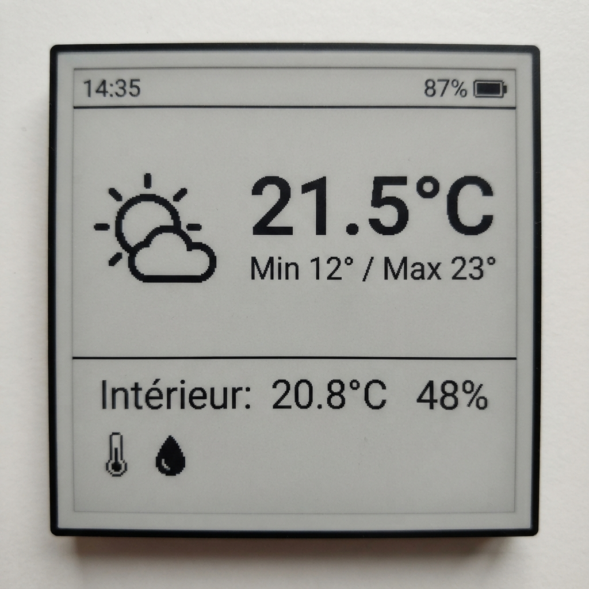

# 🌦️ Station Météo e-Paper (ESPHome & Home Assistant) / e-Paper Weather Station



[🇫🇷 Français](#-français) | [🇬🇧 English](#-english)

---

## 🇫🇷 Français

Station météo autonome sur batterie basée sur la carte **Waveshare ESP32-S3-ePaper-1.54 (Révision V2)** et **ESPHome**, conçue pour afficher les données de **Home Assistant** et les mesures intérieures locales avec une consommation ultra-faible.

### ✨ Fonctionnalités
* **Affichage e-Paper 1.54" (200×200 px)** :
  * Heure synchronisée via Home Assistant.
  * Pourcentage de batterie (`GPIO4`) et prévisions Min / Max du jour.
  * Conditions météo extérieures (icône dynamique Material Design + température).
  * Température et humidité intérieures mesurées par le capteur embarqué **SHTC3** (`I2C 0x70`).
* **Multilingue** : Changement de langue via substitution (`FR`, `EN`, `ES`, `DE`, `IT`).
* **Autonomie maximale sur batterie** :
  * Gestion matérielle spécifique à la **révision V2** (`GPIO6` pour l'écran, `GPIO42` pour le rail I2C).
  * Verrouillage matériel des broches pendant le *Deep Sleep* (`gpio_hold_en` sur `GPIO17` et `GPIO6`) évitant la coupure de l'alimentation batterie.
  * Connexion Wi-Fi ultra-rapide via IP fixe (`manual_ip`) et rafraîchissement complet toutes les 60 minutes (ou réveil manuel via le bouton `GPIO18`).
  * Interrupteur virtuel **« Bloquer Deep Sleep (Mode OTA) »** dans Home Assistant pour faciliter les mises à jour sans fil.

### 📌 Brochage matériel (Waveshare ESP32-S3-ePaper-1.54 V2)

| Composant | Fonction | Broche ESP32-S3 | Note matérielle |
| :--- | :--- | :--- | :--- |
| **Alimentation Écran** | `EPD_PWR_EN` | `GPIO6` | Actif à l'état bas (`inverted: true`) |
| **Alimentation Périph. V2** | `PERI_PWR_EN` | `GPIO42` | Alimente le bus I2C / SHTC3 (`inverted: true`) |
| **Maintien Batterie** | `BAT_PWR_LATCH` | `GPIO17` | Verrouillé à `HIGH` en veille via `gpio_hold_en` |
| **Mesure Batterie** | `BAT_ADC` | `GPIO4` | Pont diviseur ×2 (`attenuation: 12db`) |
| **Bouton Réveil** | `WAKE_BTN` | `GPIO18` | Réveil externe (`INPUT_PULLUP`, actif bas) |
| **Écran e-Paper (SPI)** | `CLK` / `MOSI` | `GPIO12` / `GPIO13` | Bus SPI matériel |
| **Écran e-Paper (Ctrl)** | `CS` / `DC` / `RST` / `BUSY` | `GPIO11` / `10` / `9` / `8` | Modèle `1.54inv2` (200×200 px) |
| **Capteur SHTC3 (I2C)** | `SDA` / `SCL` | `GPIO47` / `GPIO48` | Adresse I2C `0x70` |

### 🛠️ Prérequis matériels & logiciels
1. **Carte** : Waveshare ESP32-S3-ePaper-1.54 (**V2**, écran Noir & Blanc `1.54inv2`).
2. **Police d'icônes** : Téléchargez `materialdesignicons-webfont.ttf` et placez-le dans `/config/esphome/fonts/materialdesignicons-webfont.ttf`.
3. **Capteurs Home Assistant** : Ajoutez les capteurs suivants dans votre fichier `configuration.yaml` (ou `templates.yaml`) pour extraire les températures minimale et maximale du jour depuis votre entité météo :

```yaml
template:
  - trigger:
      - platform: time_pattern
        hours: "/1"
      - platform: homeassistant
        event: start
    action:
      - service: weather.get_forecasts
        data:
          type: daily
        target:
          entity_id: weather.forecast_maison
        response_variable: daily_forecast
    sensor:
      - name: "Météo Max Aujourd'hui"
        unique_id: meteo_max_aujourd_hui
        unit_of_measurement: "°C"
        device_class: temperature
        state: "{{ daily_forecast['weather.forecast_maison'].forecast[0].temperature }}"

      - name: "Météo Min Aujourd'hui"
        unique_id: meteo_min_aujourd_hui
        unit_of_measurement: "°C"
        device_class: temperature
        state: "{{ daily_forecast['weather.forecast_maison'].forecast[0].templow }}"
```

### 🚀 Installation et premier flashage
1. Adaptez les substitutions (`lang`, `weather_entity`) et la configuration réseau (`manual_ip`) dans le fichier YAML ESPHome.
2. Compilez et téléversez le firmware via USB-C en mode Bootloader (maintenir **BOOT** `GPIO0`, appuyer sur **RESET**, relâcher **BOOT**).
3. Ajoutez l'appareil dans **Home Assistant > Paramètres > Appareils et services > ESPHome**.
4. Débranchez le câble USB-C et effectuez un **appui long (~1,5 s) sur le bouton Power** pour enclencher le verrouillage batterie.

### 🔄 Mise à jour sans fil (OTA)
1. Activez l'interrupteur **« Bloquer Deep Sleep (Mode OTA) »** dans Home Assistant.
2. Appuyez sur le bouton de réveil (`GPIO18`) ou attendez le prochain réveil programmé.
3. Téléversez le nouveau firmware en OTA, puis désactivez l'interrupteur pour reprendre le cycle de veille.

---

## 🇬🇧 English

Battery-powered standalone weather station built on the **Waveshare ESP32-S3-ePaper-1.54 (Revision V2)** board and **ESPHome**, designed to display **Home Assistant** weather data and local indoor sensor readings with ultra-low power consumption.

### ✨ Features
* **1.54" e-Paper Display (200×200 px)**:
  * Time synced from Home Assistant.
  * Battery percentage (`GPIO4`) and daily Min / Max forecast temperatures.
  * Outdoor weather conditions (dynamic Material Design icon + current temperature).
  * Indoor temperature and humidity measured by the onboard **SHTC3** sensor (`I2C 0x70`).
* **Multi-language support**: Easy language switching via YAML substitution (`FR`, `EN`, `ES`, `DE`, `IT`).
* **Maximum Battery Life**:
  * Dedicated **V2 hardware power rail management** (`GPIO6` for display power, `GPIO42` for the I2C peripheral rail).
  * Hardware GPIO hold during *Deep Sleep* (`gpio_hold_en` on `GPIO17` and `GPIO6`) to keep the battery power latch active between wake cycles.
  * Fast Wi-Fi connection using static IP (`manual_ip`) and full display refresh every 60 minutes (or manual wake-up via button `GPIO18`).
  * Virtual **"Bloquer Deep Sleep (Mode OTA)"** switch in Home Assistant for seamless over-the-air updates.

### 📌 Hardware Pinout (Waveshare ESP32-S3-ePaper-1.54 V2)

| Component | Function | ESP32-S3 Pin | Hardware Note |
| :--- | :--- | :--- | :--- |
| **Display Power** | `EPD_PWR_EN` | `GPIO6` | Active-low (`inverted: true`) |
| **V2 Peripherals Power** | `PERI_PWR_EN` | `GPIO42` | Powers I2C bus / SHTC3 (`inverted: true`) |
| **Battery Power Latch** | `BAT_PWR_LATCH` | `GPIO17` | Held `HIGH` during sleep via `gpio_hold_en` |
| **Battery Voltage** | `BAT_ADC` | `GPIO4` | ×2 voltage divider (`attenuation: 12db`) |
| **Wake Button** | `WAKE_BTN` | `GPIO18` | External wake-up (`INPUT_PULLUP`, active-low) |
| **e-Paper Display (SPI)** | `CLK` / `MOSI` | `GPIO12` / `GPIO13` | Hardware SPI bus |
| **e-Paper Display (Ctrl)** | `CS` / `DC` / `RST` / `BUSY` | `GPIO11` / `10` / `9` / `8` | `1.54inv2` panel (200×200 px) |
| **SHTC3 Sensor (I2C)** | `SDA` / `SCL` | `GPIO47` / `GPIO48` | I2C address `0x70` |

### 🛠️ Hardware & Software Prerequisites
1. **Board**: Waveshare ESP32-S3-ePaper-1.54 (**V2**, Black & White `1.54inv2` panel).
2. **Icon Font**: Download `materialdesignicons-webfont.ttf` and place it at `/config/esphome/fonts/materialdesignicons-webfont.ttf`.
3. **Home Assistant Entities**: Add the following template sensors to your `configuration.yaml` (or `templates.yaml`) to extract today's min and max temperatures from your weather entity:

```yaml
template:
  - trigger:
      - platform: time_pattern
        hours: "/1"
      - platform: homeassistant
        event: start
    action:
      - service: weather.get_forecasts
        data:
          type: daily
        target:
          entity_id: weather.forecast_maison
        response_variable: daily_forecast
    sensor:
      - name: "Météo Max Aujourd'hui"
        unique_id: meteo_max_aujourd_hui
        unit_of_measurement: "°C"
        device_class: temperature
        state: "{{ daily_forecast['weather.forecast_maison'].forecast[0].temperature }}"

      - name: "Météo Min Aujourd'hui"
        unique_id: meteo_min_aujourd_hui
        unit_of_measurement: "°C"
        device_class: temperature
        state: "{{ daily_forecast['weather.forecast_maison'].forecast[0].templow }}"
```

### 🚀 Installation & Initial Flashing
1. Customize the substitutions (`lang`, `weather_entity`) and network settings (`manual_ip`) in the ESPHome YAML file.
2. Compile and flash the firmware over USB-C in Bootloader mode (hold **BOOT** `GPIO0`, press **RESET**, release **BOOT**).
3. Add the discovered device in **Home Assistant > Settings > Devices & Services > ESPHome**.
4. Unplug the USB-C cable and **long-press (~1.5 s) the side Power button** to engage the battery power latch.

### 🔄 Over-The-Air (OTA) Updates
1. Turn ON the **"Bloquer Deep Sleep (Mode OTA)"** switch in Home Assistant.
2. Press the wake button (`GPIO18`) or wait for the next scheduled wake-up cycle.
3. Flash the updated firmware wirelessly, then turn the switch back OFF to resume deep sleep cycles.
